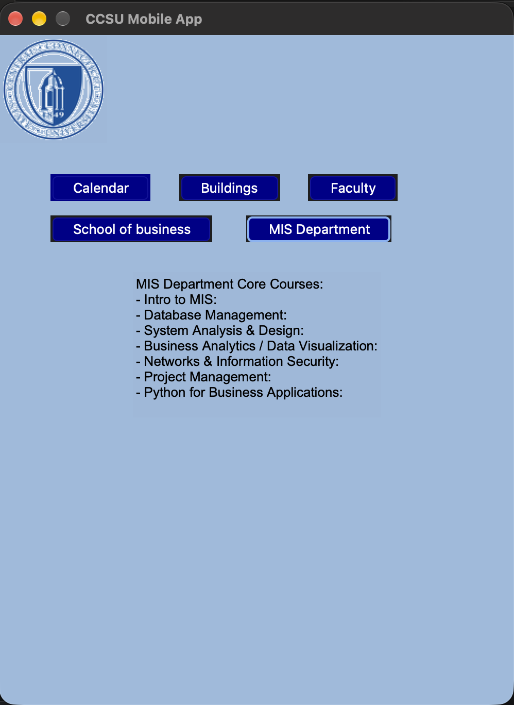

# CCSU Mobile App

A Python Tkinter desktop app styled like a simple campus mobile app for Central Connecticut State University. With one click, students can look up the Fall 2026 academic calendar, campus buildings, faculty, School of Business departments, and MIS core courses. The calendar, buildings, and faculty info is read from a CSV file with pandas.



## Course

**Midterm Project (Part 2)** – Contemporary Business Applications Development I (MIS 310)
Central Connecticut State University · Dr. Armel Djangone · Fall 2026

## Features

- **Calendar**: shows Fall 2026 academic calendar dates
- **Buildings**: lists campus buildings
- **Faculty**: lists faculty names
- **School of Business**: lists the business school's departments
- **MIS Department**: lists the MIS core courses
- Reads data from a CSV file with **pandas** and skips empty cells
- University logo with its white background made transparent using **Pillow**
- Fixed-size, phone-style window (500×650) with styled buttons from **tkmacosx**

## Technologies Used

| Library | Purpose |
|---|---|
| `tkinter` | GUI: window, labels, layout with `place()` |
| `pandas` | Reads the academic calendar CSV and filters out empty values |
| `Pillow` (PIL) | Opens, resizes, and makes the logo's background transparent |
| `tkmacosx` | Buttons with custom background colors on macOS |

## Project Files

| File | Description |
|---|---|
| `ccsu_app2.py` | The full application |
| `CCSU_Fall_2026_Academic_Calendar.csv` | Data for the Calendar, Buildings, and Faculty buttons |
| `logo1.png` | CCSU logo shown in the top-left corner |
| `requirements.txt` | Python packages the app needs |

## How to Run

1. Install **Python 3** from [python.org](https://www.python.org/downloads/).
2. Install the required packages:
   ```bash
   pip install -r requirements.txt
   ```
3. Run the app from inside the project folder, so it can find the CSV file and the logo:
   ```bash
   python ccsu_app2.py
   ```

> **Note:** `tkmacosx` is designed for macOS. On Windows or Linux, you can replace `from tkmacosx import Button` with plain Tkinter buttons.

## What I Learned

- Reading and filtering CSV data with pandas (`read_csv`, `isnull`, column selection)
- Updating a single Tkinter label dynamically to show different content
- Absolute positioning with `place()` to build a fixed, mobile-style layout
- Processing images with Pillow: resizing, converting to RGBA, and editing pixels for transparency
- Using a third-party library (`tkmacosx`) to work around Tkinter's button styling limits on macOS
